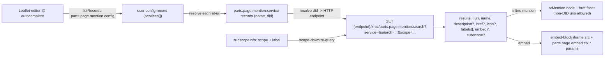
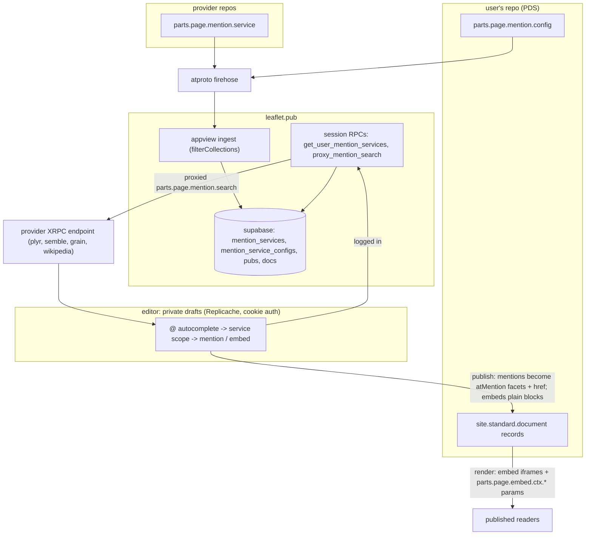

# page.parts — federated mention services

Live-verified 2026-11-07. **page.parts** is an ATProto identity —
`did:plc:de2gzyliybvjo4bfvu4i54de`, handle `page.parts`, PDS
`https://stropharia.us-west.host.bsky.network` — whose repo publishes four
lexicon schemas under the `parts.page.*` namespace. The domain
`https://page.parts` is a 302 to its
[Lexicon Garden identity page](https://lexicon.garden/identity/did:plc:de2gzyliybvjo4bfvu4i54de).
The identity is quiet (no displayName, 3 followers); the consumer that makes
the lexicons load-bearing is **leaflet.pub** (leaflets' `@`-mention
autocomplete), and a leaflet developer operates one of the live services.
Who exactly owns the DID is unverified.

## The four lexicons

All published 2026-03-28 as `com.atproto.lexicon.schema` records
([identity page](https://lexicon.garden/identity/did:plc:de2gzyliybvjo4bfvu4i54de)):

| NSID | kind | what it defines |
| --- | --- | --- |
| `parts.page.mention.config` | record (`key: literal:self`) | Per-user singleton: `services[]` — at-uris of enabled mention-service records (max 50). |
| `parts.page.mention.service` | record (`key: any`) | A mention service: `name`, optional `description`, `did` — the DID of an HTTP host that implements the search query. |
| `parts.page.mention.search` | query | `service` (at-uri) + `search` required; optional `scope`, `limit` (≤50). Returns `results[]` with `uri`, `name`, optional `description`, `href`, `icon`, `labels[]`, `embed`, `subscope`. Revised 2026-04-10 (2 versions). |
| `parts.page.embed.ctx` | param namespace | Not a record or endpoint: documents the `parts.page.embed.ctx.*` **query params** leaflet appends to service-embed iframes — `mode` (`edit`\|`view`), `bgColor`, `primaryColor` — so embedded content can match page theme and mode. |

`embedInfo` (in search results) carries an iframe `src` plus optional
`width`/`height`/`aspectRatio` for sizing; `subscopeInfo` enables scope-down
re-search within a service (e.g. plyr.fm results expose scopes `tracks`,
`artists`, `tags`).

## The model, end to end



One XRPC host can serve **multiple** services — the `service` at-uri parameter
selects which. Verified live: plyr.fm (`did:web:api.plyr.fm`) answers
`https://api.plyr.fm/xrpc/parts.page.mention.search` with tracks, artists and
tags — each carrying `subscope`, and tracks/artists carrying `embed`
(`https://plyr.fm/embed/...`) and `icon` (sample query `search=radiohead`,
2026-11-07).

## Adopters and real sample records (pulled live 2026-11-07)

Services found on the network — every one of these is a working
`parts.page.mention.service` record:

| service `name` | publisher (handle) | service `did` | note |
| --- | --- | --- | --- |
| plyr.fm | plyr.fm | `did:web:api.plyr.fm` | "search tracks, artists, and albums on plyr.fm" — XRPC verified live |
| Semble Collections | cosmik.network | `did:web:api.semble.so` | "Search semble collections" |
| Semble Cards | cosmik.network | `did:web:api.semble.so` | "Search semble cards (urls)" |
| grain | grain.social | `did:web:grain.social` | "Search and embed grain photo galleries" |
| Wikipedia | awarm.space | `did:web:jared-framework-13.cuttlefish-frog.ts.net` | a **self-hosted** service on a Tailscale node; awarm.space is a leaflet.pub developer |

A `parts.page.mention.service` record as stored (plyr.fm's):

```json
{
  "$type": "parts.page.mention.service",
  "createdAt": "2026-04-10T20:23:39.474841Z",
  "description": "search tracks, artists, and albums on plyr.fm",
  "did": "did:web:api.plyr.fm",
  "name": "plyr.fm"
}
```

A `parts.page.mention.config` enabling Semble ×2 + grain (awarm.space's
current record, rkey `3mj3vne6yql2m`):

```json
{
  "$type": "parts.page.mention.config",
  "services": [
    "at://did:plc:b2p6rujcgpenbtcjposmjuc3/parts.page.mention.service/3miho3xyx3c26",
    "at://did:plc:b2p6rujcgpenbtcjposmjuc3/parts.page.mention.service/3mihdrfdo5p23",
    "at://did:plc:e7rftrdyz5e2rw4y6ocszew2/parts.page.mention.service/3mj3fs6gy7f2e"
  ]
}
```

grain.social's own config (`rkey` `3mj5tkbj5x62t`) enables only its own
service. Adoption is small but real and cross-app: an audio app, a knowledge
tool, a photo platform, and a self-hosted Wikipedia search.

## Spec vs practice deltas

- **Config rkey**: the schema declares `key: literal:self`, but every config
  observed live uses a TID rkey (`3mj3vne6yql2m`, `3mj5tkbj5x62t`, garden
  firehose sample `3mhrocz3kdo2z`). Readers must `listRecords` and treat the
  latest (or appview-uniqued) row as the singleton — `getRecord` at rkey
  `self` finds nothing. No config writer exists anywhere in the leaflet
  checkout, so nothing in the consumer app enforces the key rule either.
- **Vendored schema runs ahead of the authority**: leaflet's pinned
  `service.json` adds an optional `canBeScopedToDid` boolean (services that
  can be scoped to a specific user's DID) which the page.parts-published
  schema does not declare; leaflet's RPC and Mention UI already consume it
  (`get_user_mention_services` returns it; `Mention.tsx` filters
  `didScopableServices`). The effective contract is the vendored pin, not the
  authority's latest publication. `search.json` and `config.json` match the
  published versions.
- **Leaflet's own doc is a generation behind**:
  [`docs/mention-services.md`](file:///home/rektide/archive/hyperlink-academy/leaflet/docs/mention-services.md)
  describes a gen-1 model (`endpoint` URL + `?search=`) that predates the
  current `did` + `parts.page.mention.search` XRPC shape in both the live
  schema and live records. Its "Open Items" (empty-did bug, "no service
  implementations exist yet") are also stale — implementations exist and are
  listed above.
- **Open-union extras in records**: plyr's record carries `createdAt`, which
  the schema does not declare — normal lexicon leniency on read, but strict
  writers must not assume the schema is exhaustive.

## How leaflet consumes it

From the archive checkout @600c7b5f (paths under
`~/archive/hyperlink-academy/leaflet/`):

- **Appview ingestion** (`appview/index.ts`): both mention collections are in
  `filterCollections`; events upsert `{uri, identity_did, record}` into
  `mention_services` / `mention_service_configs` tables (config unique on
  `identity_did` — the singleton is enforced here, not by rkey).
- **RPCs** (`app/api/rpc/[command]/`): both **session-scoped**.
  `get_user_mention_services` takes no input at all — the stale doc's
  empty-did open item was resolved by dropping the parameter; it reads the
  leaflet session identity, then the appview tables behind 60 s in-memory
  caches (config by DID, service records by uri).
  `proxy_mention_search` proxies the selected service's XRPC (5 s timeout,
  ≤50 results). Unauthenticated probes get `{"services":[]}` /
  "Not authenticated" respectively — not evidence about ingestion.
- **No config writer in the repo**: nothing in leaflet writes
  `parts.page.mention.config` — no settings UI, no putRecord anywhere in the
  checkout. The live configs were written out-of-band: provider onboarding
  (grain.social's config enables only grain's own service) or by hand; new
  configs reach readers only via the appview's firehose ingestion.
- **Editor UI** (`components/Mention.tsx`): services appear in the default
  `@` scope; Tab scopes into one; Enter inserts a `service_result` as an
  `atMention` node with `{atURI, text: name, href}`.
- **Facet/record surface**: the `atMention` facet feature gained an optional
  `href` alongside `atURI`, and `atUriToUrl()` falls back to it for non-AT
  uris — service mentions are **not** required to be at-uris or DIDs at all.
- **Embeds**: `EmbedBlock` / `IframePageView` (edit) and published
  `PostContent` (view) append `parts.page.embed.ctx.{mode,bgColor,primaryColor}`
  query params to service-embed iframe URLs.

Relevance to leafspring: extraction keeps mention plaintext today and mention
facets (`didMention`, `atMention`, footnote recursion) are deferred to v0.5
([draft-extraction](draft-extraction.glm53m.md)). When that lands,
service-derived mentions are just `atMention` facets with `href` and possibly
non-DID `atURI`s — the record side needs no parts.page knowledge. A future
`leafspring` feature could read the user's config (`listRecords`, per the
rkey delta above) and query services directly; no leaflet auth is needed for
the XRPC itself.

## The bigger picture — three planes, and page.parts lives in the input one

Leaflet has three data planes, and placing parts.page in them explains every
design choice above:

1. **Private drafts** — the editor's fact graph, synced through Replicache
   pull/push against leaflet's server under cookie auth. Entirely
   leaflet-owned; nothing here is atproto.
2. **The appview mirror** — a firehose consumer (`appview/`) upserting what
   it sees into Supabase tables (publications, documents, feeds, and the two
   mention tables). Session RPCs read *this*, not the network — which is why
   the editor's service list lags the user's repo by the firehose and needs
   a leaflet login.
3. **Published records** — canonical `site.standard.*` / `pub.leaflet.*`
   records in the user's repo: the only federated, durable output.

page.parts is leaflet's single third-party extensibility surface, and it
lives entirely in the **draft-input** direction: services shape what goes
*into* drafts (autocomplete mentions, embed blocks). The published output
needs no parts.page types at all — service mentions serialize as ordinary
`atMention` facets (plus the `href` extension), service embeds as ordinary
embed blocks whose iframes merely carry `parts.page.embed.ctx.*` params.
Downstream consumers of published documents never see parts.page.

The schema authority is likewise repo-local: leaflet pins the lexicons
(`lexicons/parts/page/*.json`, generated by `lexicons/build.ts` from
`lexicons/src/mentionService.ts`) and consumes the pin — the published
page.parts records are documentation, not a runtime dependency. That is how
`canBeScopedToDid` shipped without republication, and it mirrors how
leafspring itself pins leaflet's lexicons (experiments/04, jacquard).



## Getting sample records network-wide

There is no "search all repos for a collection" primitive in atproto —
discovery is firehose or index. What works today, verified from this machine
2026-11-07, best first:

1. **Lexicon Garden samples** — every lexicon page has a `/samples` tab:
   "N randomly sampled records from the AT Protocol firehose" with author DID
   and rkey. E.g.
   [mention.service samples](https://lexicon.garden/lexicon/did:plc:de2gzyliybvjo4bfvu4i54de/parts.page.mention.service/samples)
   (8) and
   [mention.config samples](https://lexicon.garden/lexicon/did:plc:de2gzyliybvjo4bfvu4i54de/parts.page.mention.config/samples)
   (9). This found the plyr record that seeded everything above. Also per-
   lexicon `/llms.txt`, `/analytics`, `/links`, `/compat`. Non-API but
   perfectly fetchable.
2. **Jetstream firehose filter** — the canonical live sampler, no auth:
   `wss://jetstream2.us-east.bsky.network/subscribe?wantedCollections=parts.page.mention.service&wantedCollections=parts.page.mention.config`
   (comma-list also works; mirror `jetstream1.us-west`). Verified live: the
   socket stays open under the filter; note **identity/account events bypass
   `wantedCollections`** — a 25 s probe saw 27 such events and zero
   parts.page commits, consistent with low write volume. Real-time only;
   cursor resume via `?cursor=`. Any WS client works (Node ≥22 has a global
   `WebSocket`).
3. **Relay firehose** — `wss://bsky.network/xrpc/com.atproto.sync.subscribeRepos`
   sees every repo commit with CAR blocks; filter client-side. Heavier than
   Jetstream but nothing is pre-filtered away.
4. **constellation** — `https://constellation.microcosm.blue/` (the
   microcosm project; "a self-hosted JSON API to an atproto-wide index of
   PDS record back-links"). 648 days indexed, 19.6B links. Endpoint
   `GET /xrpc/blue.microcosm.links.getBacklinks?subject=<at-uri>&source=<collection>:<json-path>`.
   In theory exactly the network-wide search wanted ("who references this
   service record?"). Empirically: works for bsky-scale links (745 likes
   counted for its example post) but returned **0 for parts.page.mention
   links** under every `source` path shape tried (`services`,
   `services[*]`, `services.0`, plus the legacy `/links?target=…` spelling).
   Watch it — indexing is real-time and backfill was advertised as "coming
   soon" — but do not count on custom collections today.
5. **pds.ls** — [David Buchanan's pdsls](https://github.com/DavidBuchanan314/pdsls),
   "browse and manage data across the AT Protocol". Human-facing SPA
   (Cloudflare-gated for plain curl); good for eyeballing a known repo's
   collections, not a network search API.
6. **Seed + walk** — the method that actually produced this doc's data:
   garden samples seed one DID, then per-DID `listRecords` on that DID's PDS
   (`{pds}/xrpc/com.atproto.repo.listRecords?repo=<did>&collection=<nsid>`)
   pulls full records; configs' `services[]` point at more DIDs to walk.
   `public.api.bsky.app` no longer serves `com.atproto.repo.*` reads — go to
   the account's PDS (from its DID doc).
7. **leaflet.pub's own aggregator** — `POST /api/rpc/get_user_mention_services`
   answered `{"services":[]}` in this session's probes, but for a mundane
   reason established from source afterwards: the RPC is session-scoped (no
   input; anonymous callers get the empty-list path), and
   `proxy_mention_search` 401s unauthenticated. It is leaflet's logged-in
   view of its appview tables, not a network index.

## Open questions

- Who operates the page.parts DID, and will `canBeScopedToDid` be (re)published
  so the authority schema catches up to leaflet's pin?
- Does any writer ever honor `literal:self`, or is the config rkey
  permanently TID in practice? (Watch new configs on Jetstream.)
- Will constellation's index grow to cover custom collections' links? If so,
  it becomes the answer to "who enabled this service" in one query.
- Nothing observed writes `parts.page.embed.ctx` records — it exists purely
  to namespace iframe params; keep it out of record-type tooling.
